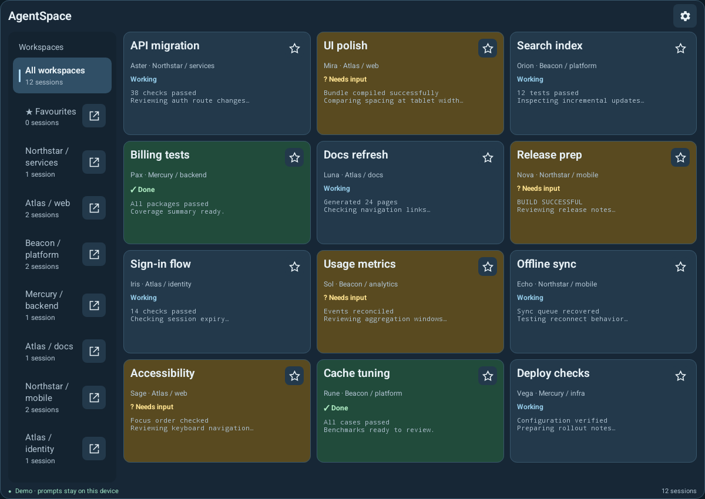
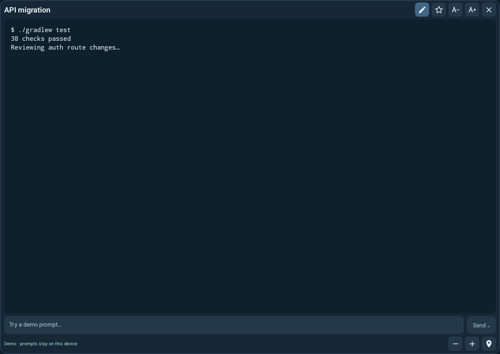
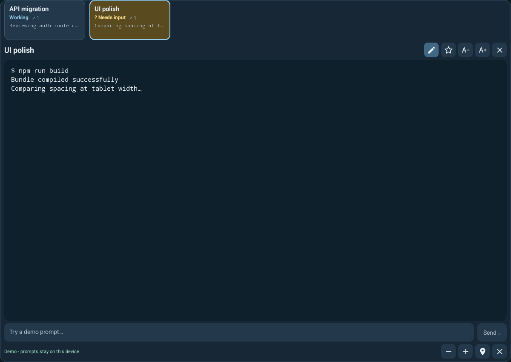
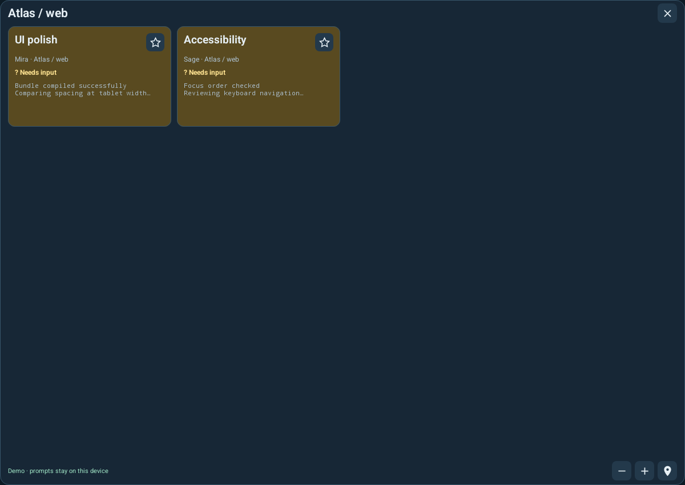
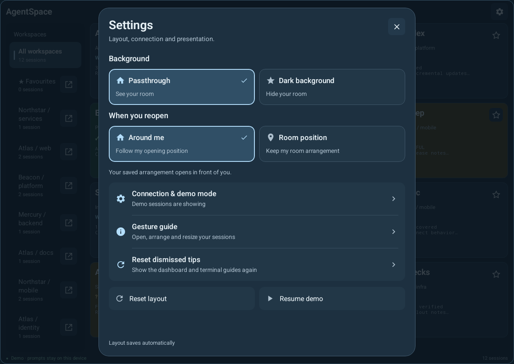
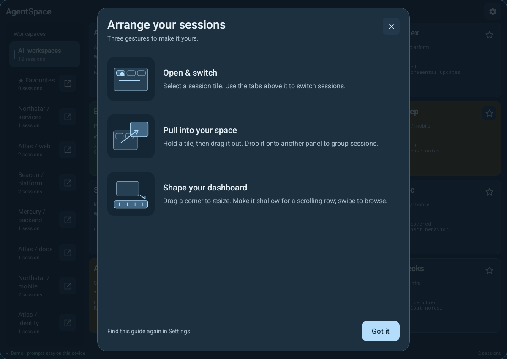

# AgentSpace Quest

A native Quest app for viewing Herdr agent sessions in movable windows. Built with Kotlin, Jetpack Compose and Meta Spatial SDK. This is an experimental developer application.

## Features

- Live session tiles, workspace filtering, favourites and terminal previews.
- Quest Home windows alongside the virtual environment, plus an optional immersive workspace with draggable tab groups.
- Resizable dashboards, compact terminal controls and saved layouts.
- A self-contained demo mode for presentations without live session data.
- SSH host verification and per-headset keys. Live observation is read-only by default; text submission is an explicit pairing option.
- Per-session drafts using the system keyboard or a physical keyboard. Dictation uses the system keyboard microphone when the headset provides it.

## Screenshots

Actual app UI rendered in an Android emulator with synthetic demo sessions. These captures show the panels; their placement in the Quest environment is controlled on the headset.



<details>
<summary>Session windows, settings and gesture guide</summary>

**Single session** — a compact title bar and controls leave room for session content.



**Tab group** — switch between sessions within one window.



**Workspace window** — browse a workspace in its own panel.



**Settings** — connection, presentation and layout controls.



**Gesture guide** — instructions for opening, grouping and resizing panels in immersive mode.



</details>

## Build and install

Requirements: JDK 17, Android SDK platform 35, Python 3 for the bridge/tests, and a Quest 3 or 3S with Horizon OS 69 or later. Set `ANDROID_HOME` to your SDK location (or use an ignored `local.properties`). The first build needs network access to download dependencies.

```sh
./scripts/build.sh
./scripts/install.sh
```

Enable developer mode and USB debugging on your headset before installation. The install script launches the dashboard in Quest Home. Immersive mode is available in Settings. `ADB` can select an alternate adb executable; `ANDROID_SERIAL` selects a device if more than one is connected.

The build script runs the debug build, JVM tests and Android lint. Its APK is at `app/build/outputs/apk/debug/app-debug.apk`. Local signing material and caches are kept in ignored `.local-build/` by default. Keep the same development signing key when installing updates; a differently signed APK cannot update an existing installation without uninstalling it and losing its app data.

Optional build overrides: `GRADLE_BIN`, `AGENTSPACE_BUILD_STATE`, `GRADLE_USER_HOME`, `ANDROID_USER_HOME`. These are development builds; this repository does not include signed release binaries or signing keys.

## Connect to Herdr

Demo mode needs no computer connection. For live sessions, run Herdr on a Mac with SSH Remote Login enabled and reachable from the headset. The bridge uses the existing Herdr CLI and server socket; Herdr itself is not included here.

1. In AgentSpace, open **Settings → Connection & demo mode** and generate the headset's dedicated public key. Save that public key to a local file on the Mac.
2. From a stable checkout location, pair it:

   ```sh
   python3 scripts/pair-headset.py --public-key /path/to/headset.pub
   ```

   The default Herdr executable is `~/.local/bin/herdr`, and the socket is `~/.config/herdr/herdr.sock`. Use `--herdr` and `--socket` to override them. The pairing script updates only this public key's entry in `~/.ssh/authorized_keys`.
3. Enter the Mac address, SSH port and username in AgentSpace. Choose **Check Mac identity**, compare the displayed fingerprint with the Mac's host key, then trust and connect:

   ```sh
   ssh-keygen -lf /etc/ssh/ssh_host_rsa_key.pub -E sha256
   ```

Pairing defaults to catalog and terminal observation. Add `--allow-input` to the pairing command to permit explicit text submission. Sending types the draft and presses Enter in the selected remote session. A send whose result is unknown is never retried automatically.

The authorized key records the bridge script's absolute path. Keep the checkout there, or pair again after moving it. Re-run the pairing command with `--remove` to revoke access. See [SECURITY.md](SECURITY.md) for the trust boundary and handling of private data.

## Window behaviour

In Quest Home, use an open-window icon to detach a session, workspace or favourites collection. Quest handles movement, resizing and dismissal. In immersive mode, long-press and drag tiles to detach or group them. Closing a view never stops the remote session.

Demo and live layouts are stored separately. The immersive **Around me** restore option places windows around your current position; **Room position** uses the play area's coordinates, not persistent spatial anchors. Quest controls Home window positions.

## Tests

```sh
python3 -m unittest discover -s scripts -p 'test_*.py' -v
```

An optional Herdr CLI integration test uses a disposable fake server and does not write to live sessions:

```sh
HERDR_TEST_BINARY=/path/to/herdr python3 -m unittest discover -s scripts -p 'test_*.py' -v
```

JVM tests and lint run through `scripts/build.sh`. Test fixtures under `docs/fixtures/` are synthetic. See [docs/architecture.md](docs/architecture.md) for the main components and [docs/release-checklist.md](docs/release-checklist.md) before distributing a build.

## Current limitations

- Transport is SSH, not Mosh. Interrupted observations reconnect; terminal input is not automatically replayed.
- Observation displays the supplied terminal screen, not a complete conversation transcript. Reconnect after resizing the Mac terminal to refresh its dimensions. Older Herdr servers may fall back to a fixed projection.
- Up to 16 terminal streams are active at once; queued tile previews can be stale.
- Home and immersive mode have different grouping and restoration controls. Home does not automatically reopen every saved window.
- Dictation availability depends on the Quest system keyboard. AgentSpace includes no separate speech-recognition service.
- The bridge addresses one configured Herdr server. Multi-computer aggregation is not implemented.

## License

AgentSpace's original code is licensed under [MIT](LICENSE). Vendored components and external dependencies retain their own licenses. See [THIRD_PARTY_NOTICES.md](THIRD_PARTY_NOTICES.md); the MIT license does not relicense Meta SDKs or third-party source.
